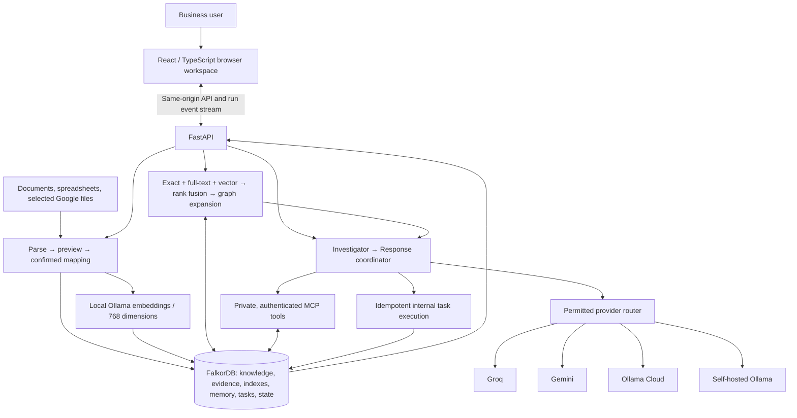

# Workweave

**Company knowledge that connects to coordinated work.**

## October 16 Ollama Cloud adapter

Ollama Cloud is the default answer provider for new workspaces, with backend-only Bearer authentication and the existing graph tools, conversation history, and processing boundaries. Existing workspaces keep their saved preferences and can switch in Settings → AI answers. Self-hosted document embeddings remain unchanged. See [Ollama Cloud setup](docs/ollama-cloud.md) for the hidden-key helper, deployment secrets, and the remaining embedding-hosting requirement. The adapter is covered by simulated HTTP tests; live authenticated operation requires an API key.

## October 15 company setup and answer update

The workspace now guides users through Documents, People & roles, and Ask. Explicit role and responsibility patterns produce source-backed suggestions that require confirmation; contacts and login accounts remain separate. Initial setup and the Company form can draft company details from accepted documents. Missing information is a normal answer outcome. Basic supported facts can be answered directly from source text, ordinary questions use one generation call, and chat recovers saved answers after an event-stream disconnect.

See [the simple user guide](docs/simple-guide.md) for the flow, limitations, graph storage explanation, and performance changes.

## October 14 reliability and interface update

The active browser app uses Next.js and a restrained Workweave design system. Setup creates a real workspace, uploads files for server-side parsing, reviews mappings, imports accepted records, and persists company confirmation. Saved setup and pending import previews resume after refresh. Processing results and database status come from the backend.

Normal company signups cannot change shared runtime provider credentials. Platform administration is restricted to the bootstrap account. Connection status exposes mode and TLS without passwords or connection URLs.

To use an existing FalkorDB Cloud instance, follow [cloud setup](docs/cloud-setup.md). The hidden-password helper saves separate connection fields in `.env`; `docker-compose.cloud.yml` uses the remote graph without requiring a local database. The browser and API still need hosting for a public deployment.

These changes were made on October 14 before the hackathon build window and remain disclosed preparation work. The existing eligibility disclosure still applies.

Workweave is a local browser application for businesses that want agents to understand company documents, investigate operational changes, identify responsible teams, create internal review tasks, and remember what actually happened. FalkorDB is the authoritative store for knowledge, retrieval indexes, evidence, conversations, memory, tasks, and run checkpoints.

This is a **disclosed pre-event prototype**, built October 10, 2026. It is preparation for the FalkorDB hackathon, not a claim that this implementation was created during its event window. Legacy scaffolding was removed upon request; the project now lives in the `workweave` folder. See `docs/prototype-disclosure.md` and the [organizer's rules](https://www.wemakedevs.org/hackathons/falkordb/rules) before preparing the main submission.

## What the prototype does

| Capability | Status |
|---|---|
| Work dashboard, task statuses, evidence inspector, company/profile, assistant, sources, memory, settings | Implemented |
| Light, dark, and saved system theme; responsive rail and investigation drawer | Implemented; browser checked |
| Local administrator, server-side sessions, company membership, private conversations | Implemented; authorization tested |
| XLSX, CSV, TXT, Markdown, text-based PDF, and DOCX parsing | Implemented; preview and mapping confirmation |
| Stable identifiers, source versions, spreadsheet row locations, conflict checks, source revocation | Implemented |
| Exact, full-text, local vector retrieval, ranking fusion, graph expansion, prior episodes | Implemented; local embeddings/vector query checked |
| Groq, Gemini, Ollama generation and tool adapters; permitted fallback and local-only policy | Implemented; real local answer tested, cloud adapters tested with simulated responses |
| Private authenticated stdio MCP tools | Implemented; subprocess integration tested |
| Delivery-change Investigator → Response coordinator, internal tasks, receipts, checkpoints | Implemented for the supplier-delay workflow |
| Semantic context, episodic outcomes, approved versioned procedures, private conversation memory | Implemented |
| Selected Drive files/Google Docs and native Google Sheets adapters, OAuth/Picker, manual synchronization | Implemented behind a disabled product flag; live Google authorization not verified |
| Arbitrary business workflows, scheduled Drive synchronization, automatic retention deletion, invitations UI | Planned |
| OCR, OneDrive, spreadsheet writeback, autonomous email/ERP changes, desktop packaging, voice | Deferred |

Documents work for any company. Operational relationship mappings currently cover Supplier, Product, PurchaseOrder, SalesOrder, Team, and general BusinessRecord records. The autonomous change workflow demonstrates supplier delays; it does not yet infer every possible business workflow from a guide.

## Why a graph

Retrieving a paragraph can explain what a supplier wrote. A graph can connect that supplier to purchase orders, products, customer commitments, responsible teams, evidence versions, and previous investigations. Workweave combines both.

The demo follows `SalesOrder → PurchaseOrder → Supplier`, checks delivery dates against required dates, accounts for explicitly recorded **unallocated** stock in commitment-date order, and resolves current ownership through `OWNED_BY → Team`. Only affected commitments create review tasks. Each finding cites the current source version and its workbook/CSV location.

Removing FalkorDB disables investigation and memory explicitly. There is no alternate JSON or vector database that silently replaces its role.

## Architecture



Compose runs a frontend Next.js service, FastAPI, FalkorDB, and Ollama. Only the browser endpoint is published, bound to `127.0.0.1`. API, database, and model runtime are internal to the Compose network. One background executor processes agent runs; intake can accept concurrent requests.

`ww_control` holds accounts, hashed passwords, server sessions, company membership, and provider policies. Each company uses its own `ww_company_<identifier>` graph. Backend membership checks choose the graph before any retrieval or tool execution.

Credentials are stored in environment configuration or an encrypted local vault outside business graphs and prompts. The vault key lives beside its encrypted file, so protect the application data volume and host account. Cloud credentials are local-runtime settings; only the local administrator can change them. Their values are never returned by the provider-readiness API.

### Graph schema

`Record` nodes provide stable IDs and persisted state, with typed labels including `Entity`, `Chunk`, `Source`, `Profile`, `Procedure`, `Conversation`, `Message`, `Run`, `Task`, and `Episode`. Business fields are projected onto Entity nodes for dependency queries. Structured tables stay structured; chunks link to their source version.

Relationships include `DEPENDS_ON`, `OWNED_BY`, `SUPPORTED_BY`, `HAS_CHUNK`, `SUPERSEDES`, `BASED_ON`, and `PRODUCED`. Task receipts are persisted with deterministic task IDs. Company descriptions and approved procedures never grant tool permissions.

```cypher
MATCH path=(order:Entity {entity_type:'SalesOrder',active:true})
  -[:DEPENDS_ON*1..4]->(supplier:Entity {id:$supplier_id,active:true})
WHERE all(node IN nodes(path) WHERE node.active=true)
RETURN order.id, [node IN nodes(path) | node.id]
```

Candidate graph paths are subsequently checked against current source versions, dates, quantities, stock, and current team ownership. Graph connectivity alone is not treated as proof of disruption.

FalkorDB has a range index on stable Record IDs, a full-text index on Chunk text, and a 768-dimensional cosine vector index. See [FalkorDB indexing](https://docs.falkordb.com/cypher/indexing), [vector indexes](https://docs.falkordb.com/cypher/indexing/vector-index), and [persistence](https://docs.falkordb.com/operations/durability/persistence).

## Run locally with Docker

Requirements: Docker Desktop with Linux containers, available localhost port 8080, internet for initial image/model downloads, and sufficient disk space. The full local answer model is about 5.2 GB; embeddings are about 621 MB. CPU generation works without a GPU but may be slow. Hosted inference is optional.

From `C:\Users\CLASSIC\Desktop\workspace\workweave`:

```powershell
Copy-Item .env.example .env
# Set WORKWEAVE_ADMIN_PASSWORD in .env before the first start, or use the generated password.
docker compose up -d --build
docker compose exec ollama ollama pull embeddinggemma:300m
docker compose exec ollama ollama pull qwen3:8b
```

Open **http://localhost:8080**. Sign in as `admin`. If no initial password was configured, retrieve it locally:

```powershell
docker compose exec api cat /data/workweave/bootstrap-password.txt
```

The initial password is used only when the administrator account is first created. Editing the environment later does not silently change the existing account's password.

Create a workspace, such as **Harbor Supply**, and select **Explore Harbor Supply demo**. The demo button is available for an empty workspace. It imports synthetic source snapshots, updates a purchase-order delivery date, traces dependencies, creates review tasks, and stores an episode. Its answer is clearly labelled **deterministic graph workflow**, so it can demonstrate graph correctness without a generation provider.

The expected affected orders are **SO1 / Acme cartons** and **SO2 / Beacon cartons**. **SO3** is timely, **SO4** is covered by recorded stock, and **SO5** belongs to unrelated supply. Select the investigation to inspect commitments, versions, row locations, dependency paths, tasks, and run progress. Mark a task done; inspect the outcome in Memory.

For an actual model answer, download Qwen3 or configure a hosted provider in Settings. If files were imported before embeddings were installed, use **Rebuild local indexes** in Sources. Exact/keyword/graph retrieval remains available when semantic retrieval is degraded.

Data persists in named graph, credential, and model volumes. The database uses AOF with `appendfsync everysec` plus snapshots; the durability window can be approximately one second. Restarting services retains data. Removing named volumes removes their stored state.

## Models and processing policy

| Role | Default model |
|---|---|
| Primary generation | Groq `openai/gpt-oss-120b` |
| Hosted fallback | Gemini `gemini-3.5-flash-lite` |
| Local generation fallback | Ollama `qwen3:8b` |
| All document/query embeddings | Ollama `embeddinggemma:300m`, 768 dimensions |

The router tries Groq → Gemini → Ollama Cloud → self-hosted Ollama, using only configured and allowed providers. Cloud consent starts off. Local-only mode prevents hosted generation calls. Missing keys/models are skipped or reported; authentication failures disable a provider until its key is corrected. Rate limits create cooldowns, transient failures are retried once, and total failure leaves a resumable checkpoint.

Evidence and completed tool results survive provider switches. Tool receipts prevent repeating completed actions. Provider response streams are buffered and checked before cited answer fragments are published to the browser; progress events arrive during retrieval/generation. Interrupted provider output is discarded instead of concatenated with a conflicting answer.

Generation-model switching does not change the embedding model or erase memory. Use the same embedding space for ingestion and queries; changing dimensions requires deliberate reindexing. See [Ollama embeddings](https://docs.ollama.com/capabilities/embeddings).

Groq and Gemini account eligibility, available models, and free quotas must be checked at setup. Workweave does not guarantee unlimited free inference. See [Groq limits](https://console.groq.com/docs/rate-limits), [tool use](https://console.groq.com/docs/tool-use/overview), and [Gemini pricing/data treatment](https://ai.google.dev/gemini-api/docs/pricing). Gemini free-tier inputs may be used to improve Google products; the setup UI explains the destination before cloud processing is enabled. A ChatGPT Plus subscription is not used as an API credential by this app.

## Ingestion, retrieval, and memory

Onboarding: **business description → source selection → parsing preview → confirmed column mapping → confirmed company understanding → workflow activation**.

An uploaded workbook is a snapshot. Re-uploading its filename reconciles its version and stable keys. Every table requires unique headings and identifiers. Invalid dates, duplicate keys, negative/non-finite stock or quantities, unsupported file types, and conflicting authoritative records are rejected. Formula cells use cached values; macros are not executed and workbooks are not recalculated. Scanned PDFs need OCR, which is deferred.

Document chunks approximate 500 tokens with roughly 80-token overlap and preserve section/page/paragraph boundaries. Spreadsheet evidence keeps the sheet/table and row location; accepted row data stays structured in the graph. Sources retain version hashes, import timestamps, source removal state, and historical evidence.

Retrieval authorizes membership, finds exact identifiers/keywords, queries local vectors, combines rankings, filters current evidence, expands confirmed dependency/ownership relationships, and recalls permitted episodes and approved procedures. Revoked/superseded evidence is filtered before model context is built. Saved summaries cannot reintroduce invalidated evidence. Answer validation checks that every claim cites evidence IDs returned during its run; it does not prove semantic entailment or eliminate the need for human review.

The Company screen can request evidence-cited candidate facts from uploaded guides. These remain a draft until an administrator reviews and confirms them. Manual confirmation works without a model. A source document is evidence, not an application instruction.

| Memory type | Meaning |
|---|---|
| Semantic | Confirmed profile, accepted table facts, owners, dependencies |
| Episodic | Investigations, evidence, actual task status/outcomes |
| Procedural | Approved procedure versions; superseded versions remain inspectable |
| Conversation | Messages private to their creator and company |
| Coordination | Agent handoffs, run checkpoints, internal tasks, persisted receipts |

The Investigator persists findings before handoff. The coordinator consults current owners/procedures before creating tasks. Tasks use stable IDs derived from the run/finding, so recovery reconciles prior actions. A remembered outcome does not become an approved procedure automatically.

## MCP and API

The private stdio MCP server exposes `search_knowledge`, `trace_impact`, `find_owner`, `get_procedure`, `recall_episode`, and `create_review_task`. A short-lived server-side session binds it to one authorized user, company, and run. No unauthenticated public MCP endpoint is exposed. Models cannot submit unrestricted Cypher or arbitrary external tools.

All browser APIs use `/api/v1`. Route families cover authentication, companies/membership, profiles, uploads/import confirmation, sources/reindex/revocation, conversations/messages, runs/events/resume, evidence, tasks, memory, providers/policies, and gated Google connections. `/docs` exposes FastAPI's OpenAPI schema. Shared browser types include EvidenceReference, Finding, GraphPath, Task, MemoryEntry, and RunStatus.

Sending a message creates a distinct persisted user message and an asynchronous run. The browser reads one run event stream and renders a separate assistant message. It never attempts to read JSON from a response body it has already consumed as a stream.

## Optional Google product profile

Private Google sources are disabled for the event demo. For a separate product deployment, enable `WORKWEAVE_ALLOW_PRIVATE_DRIVE`, configure an OAuth client/secret, registered redirect URI, restricted Picker browser API key, and Google project number, and enable Drive/Sheets/Picker APIs. The connection requests `drive.file`, uses Google Picker to select permitted files, exports native Docs, and uses a separate native Sheets adapter. Credentials and refresh tokens remain in the local vault.

Manual Sync validates changed records against the prior mapping and asks for mapping review if the schema changes. Missing/revoked files invalidate their evidence. Automatic polling and broader folder synchronization are planned. Live OAuth/Picker operation requires your Google project credentials and has not been verified in this session. See [Google scopes](https://developers.google.com/workspace/drive/api/guides/api-specific-auth) and [download/export](https://developers.google.com/workspace/drive/api/guides/manage-downloads).

## Development and validation

Active code lives in `workweave-api/workweave_api` and `workweave-web/src`. Use Python 3.11+ and Node 22.12+:

```powershell
cd workweave-api
python -m venv .venv
.venv\Scripts\python -m pip install -r requirements.txt
# Set WORKWEAVE_GRAPH_URL and WORKWEAVE_OLLAMA_URL for your development services.
.venv\Scripts\python -m uvicorn workweave_api.main:app --host 127.0.0.1 --port 8088
```

In a second terminal:

```powershell
cd workweave-web
bun install --frozen-lockfile
npm run dev
# Next.js on localhost:3000 proxies /api to 127.0.0.1:8088.
npm run build
```

The prototype API can also serve the built browser files from `workweave-web/dist` directly at port 8088. The supplied Compose deployment serves them through Next.js at port 8080. FalkorDB and Ollama 0.40.1 are pinned to verified image digests.

Acceptance tests use a separate disposable FalkorDB at port 16380:

```powershell
docker run -d --name workweave-acceptance-db -p 127.0.0.1:16380:6379 -e BROWSER=0 falkordb/falkordb@sha256:e2765e207e5ba4ee90e47ed31eb7491ad6dd3d42241c326e429375c02ad9882f
cd workweave-api
.venv\Scripts\python -m pip install pytest pytest-asyncio
.venv\Scripts\python -m pytest tests/test_acceptance.py tests/test_mcp.py tests/test_drive.py -q
```

Validation checks include expected/excluded commitments, current evidence locations, changed owners/procedures, idempotent recovery, private conversations/episodes, company isolation, rejected unapproved tool schemas, revoked-evidence retrieval, concurrent message preservation, permitted-provider fallback, incomplete streams, and local-only inference. Browser checks cover six screens, both themes, four viewport widths, horizontal overflow, an evidence modal/keyboard close, and CSV mapping/import.

The eight-request concurrent intake check measured approximately **0.13 seconds** in the final run (2.1 seconds in an earlier run) on this machine. This is an intake observation, not an inference throughput benchmark; generation and actions remain serialized. Cloud-provider tests use simulated HTTP responses because no live API keys were supplied. A real local Qwen3 ownership answer passed in approximately 92 seconds on this CPU setup after bounding context. CPU model latency and account quotas vary.

## Hackathon story

Track 01: an agent acts on company data by investigating a delivery change and creating internal review tasks. Track 02: agents hand off findings, retain episodes, update outcomes, and resume from checkpoints. Track 03: company guides, structured operational records, and current evidence ground answers.

The strongest demonstration is a concrete change → dependency trace → justified exclusions → current owner → internal task → restart → remembered outcome. Keep preparation, existing work, and event-window implementation disclosed accurately. This prototype does not promise eligibility, originality, or a prize.

