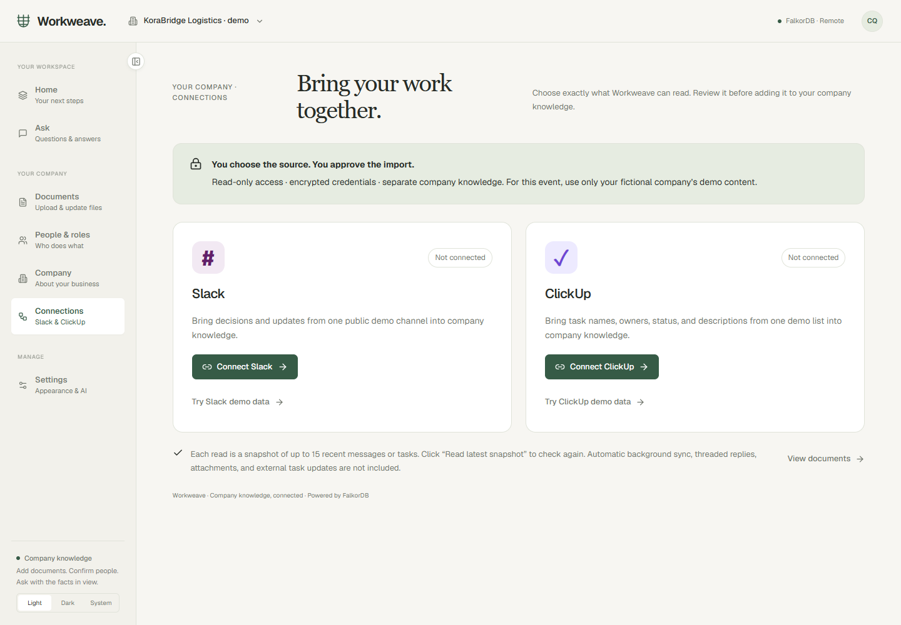
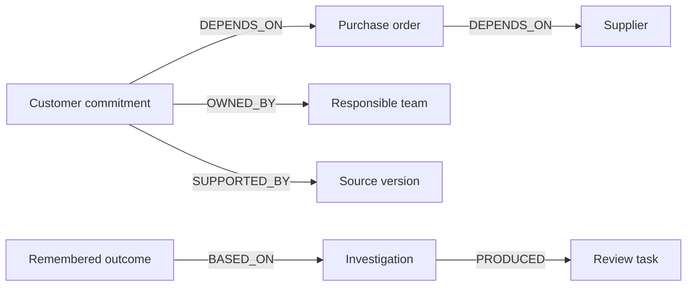
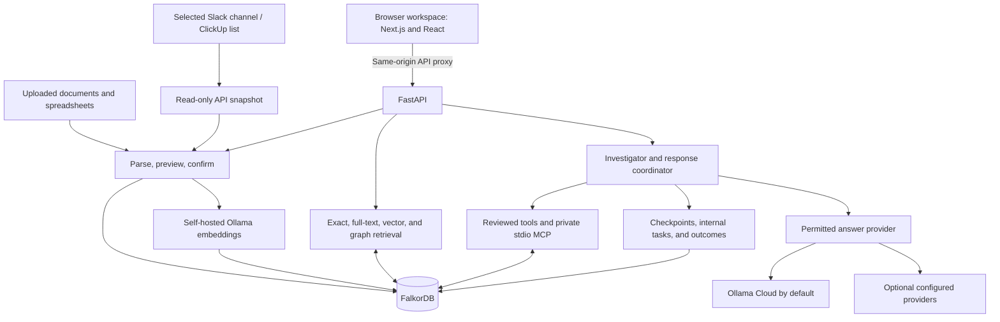

# Workweave

**Ask your company a question. Follow the evidence. Keep the next step accountable.**


Workweave turns company documents and spreadsheets into a shared company brain.
It connects accepted facts, responsibilities, operational dependencies, and past
outcomes in **FalkorDB**, so answers can point back to their sources.

Think of it as a company notebook that can answer, “Who owns this?”, explain why a
change matters, and remember what your team did about it.

**Graph Hacks track: Company Brain.**

[Open Workweave](https://workweave-web.fly.dev) · [Try the company packs](docs/testing/README.md) · [Connect Slack / ClickUp](docs/workplace-connections.md) · [Graph model](docs/graph-model.md) · [Cypher queries](docs/graph-queries.cypher) · [Project story](docs/workweave-blog.md)

**Demo video:** the 3:30 walkthrough has been recorded locally. Its public viewing
link is still required before submission. A workplace-connection scene will be
added after testing the participant's synthetic Slack and ClickUp accounts.

> **Build-history disclosure:** an earlier version of this repository described a
> pre-event prototype. That history is preserved in the [submission disclosure](docs/submission-disclosure.md).
> This README does not claim that the existing graph implementation was first
> written during the event, or that eligibility has been confirmed.

## The problem it solves

A company can have a delivery procedure in one document, a purchase order in a
spreadsheet, and the responsible team somewhere else. Finding a relevant paragraph
is useful, but it does not establish which commitments depend on a delayed order.

Workweave supports two connected paths:

- **Company questions:** upload a profile, procedure, or report; review what was
  imported; ask a question; open the source behind the answer.
- **Operational investigations:** import supported structured records; detect a
  supplier delivery change; trace affected commitments; identify their owners;
  create internal review tasks; retain the investigation and its outcome.

For example, the included late-shipment scenario follows recorded dependencies
to four customer orders. Two need review; two are excluded because of their dates
or available stock. A fifth order is outside those paths and is not assessed.
The explanation shows the evidence and the limits of the investigation.

## Try it in a few minutes

1. Open [the app](https://workweave-web.fly.dev) and create an email/username account.
   Choose your work area, starting focus, and workspace name.
2. Pick one fictional company below. Upload its three documents individually,
   preview them, and confirm the imports.
3. Review **People & roles** and **Company**. Correct the suggestions before saving.
4. Open **Ask**. Start with the suggested question, then open its source citation.
5. Use **History** to revisit a conversation after refreshing or signing back in.

The industry form adjusts setup guidance. It does not generate an entire custom
application or infer responsibilities that were never provided.

### Four prepared company packs

All four companies, their people, figures, and events are synthetic. Each folder
contains a searchable PDF company profile, a Markdown procedure, and a text report.

| Company | Documents | Try asking |
| --- | --- | --- |
| KoraBridge Logistics | [Delivery operations pack](docs/01_korabridge_logistics/) | Who owns Project Atlas and what are its budget and target date? |
| Sunvale Energy Systems | [Solar-project pack](docs/02_sunvale_energy/) | Who owns Project Lumen and which site is blocked? |
| Cedargrain Foods | [Production and quality pack](docs/03_cedargrain_foods/) | Who can release CGF-LOT-410, and is a release date confirmed? |
| Meridian Harbor Software | [Software operations pack](docs/04_meridian_harbor_software/) | Who owns Atlas, when is it planned, and has it shipped? |

Use a **separate workspace for each company**. Download the files from the
repository and upload the three actual documents, rather than their folder or ZIP.

The [testing guide](docs/testing/README.md) includes **24 questions** and a separate
answer key. Keep the reviewer questions and answers outside Workweave: uploading
the answer key would invalidate the test. Repeated names and project names help
check that companies' knowledge stays separate. Missing facts test whether the
app admits that it does not know.

Narrative documents test source-grounded answers. They do not automatically create
all the typed order/supplier relationships used by the operational workflow.

### Connect work where it happens

Open **Connections** in the company sidebar. Select **Slack** or **ClickUp**, enter
the credential privately, and choose one fictional demo channel or task list.
**Read & preview → Confirm & import → Ask with source evidence.**

**No accounts or tokens for a quick test:** choose **Try Slack demo data** or
**Try ClickUp demo data**. Review and confirm the fictional messages/tasks. These
fixtures are labelled synthetic and do not show a live connection as successful.



| Tool | Credential | What this version reads |
| --- | --- | --- |
| Slack | Bot token + public channel ID | Up to 15 recent top-level text messages |
| ClickUp | Personal token + list ID, for your own demo account | Up to 15 tasks, with names, status, assignees, and descriptions |

Tokens stay encrypted on the backend and are not stored in company graph payloads.
Nothing is posted back to either tool. Re-read a selected source when you want a
new snapshot; this release has no scheduled sync or webhooks. Content enters
company knowledge only after you confirm its preview. A workspace-tool snapshot
does not automatically create typed supplier/order dependencies.

The adapters and demo mode are tested with controlled API responses. Real-account
verification is pending the participant's connection of their synthetic workspace.
Free-plan setup, permissions, limits, and disconnection are explained in the
[connection guide](docs/workplace-connections.md). Public multi-customer OAuth
onboarding is future work; this version uses administrator-supplied demo tokens.

## Why FalkorDB is essential

FalkorDB is the application's primary store, not a graph drawn over another
business database. It holds accepted company knowledge, source versions, search
indexes, people, conversations, investigations, tasks, and memory.



The operational tool follows recorded dependency paths, then checks dates,
quantities, current evidence, and unallocated stock. The model does not invent
joins or write arbitrary Cypher. Removing FalkorDB stops company retrieval,
investigations, and persistent memory; there is no substitute business-data store.

There is one control graph, `ww_control`, and a separate knowledge graph per
company, named `ww_company_<identifier>`. Membership checks select the graph before
search or tool execution. Conversations and private episodes also check the author.

Actual labels, properties, relationships, tenant boundaries, and memory handling
are documented in the [graph model](docs/graph-model.md). All stored nodes have a
`Record` label plus their typed label; full record data is in `payload`, with
queryable business fields also projected onto `Entity` nodes.

### A core query

This is the candidate traversal from `trace_impact`. `$id` must resolve to a
current entity before execution. Application checks determine actual impact;
connectivity alone is not treated as a disruption.

```cypher
MATCH path=(o:Entity {entity_type:'SalesOrder',active:true})
  -[:DEPENDS_ON*1..4]->(target:Entity {id:$id,active:true})
WHERE all(n IN nodes(path) WHERE n.active=true)
MATCH (o)-[:DEPENDS_ON]->(po:Entity {entity_type:'PurchaseOrder',active:true})
OPTIONAL MATCH (o)-[:DEPENDS_ON]->(product:Entity {entity_type:'Product',active:true})
RETURN DISTINCT o.payload AS order_json, po.payload AS po_json,
  product.payload AS product_json, [n IN nodes(path) | n.id] AS path_ids
ORDER BY o.required_date
```

See [the query catalogue](docs/graph-queries.cypher) for ownership, graph expansion,
full-text search, vector search, persisted-state lookup, and indexing templates,
with links to their implementations in the [graph model](docs/graph-model.md).

## Architecture



The hosted frontend and backend are separate Fly apps. The browser uses the
frontend's API proxy; backend writes accept only the configured frontend origin.
Keys stay on the backend. Its persistent volume holds encrypted provider/OAuth
credentials, while company knowledge and application state live in FalkorDB.

For ordinary questions, the backend retrieves current evidence and generates a
source-grounded answer. Some narrow facts can be answered directly. Requests
requiring relationship tools use the bounded tool loop. The private MCP catalogue
contains `search_knowledge`, `trace_impact`, `find_owner`, `get_procedure`,
`recall_episode`, and `create_review_task`.

Semantic memory stores accepted facts; episodic memory stores investigations and
outcomes; procedural memory stores approved procedure versions. Handoffs and
checkpoints are persisted. One background executor coordinates the workflow;
this is not a distributed multi-agent concurrency system.

## Run locally

Requirements: Docker with Linux containers and an available port **8080**.
Run these commands from the repository root.

**First-time configuration only:** if you do not already have `.env`, copy
`.env.example` to `.env` and set your own bootstrap administrator password. Keep
existing configuration and credentials; do not overwrite them with an example.

```bash
docker compose up -d --build
docker compose exec ollama ollama pull embeddinggemma:300m
```

Open **http://localhost:8080** and create an account. The bootstrap `admin` account
is for platform administration; its initial password is used only when that
account is first created.

The app-wide default starts with **Ollama Cloud** (`gemma4:31b`), then tries configured **Groq → Gemini → self-hosted Ollama** fallbacks when needed. New accounts and workspaces inherit that default. Configure
`WORKWEAVE_OLLAMA_CLOUD_KEY` on the backend, or use the
[hidden-key setup helper](docs/ollama-cloud.md). The embedding model above remains
separate from cloud chat.

For a fully local answer model, also run:

```bash
docker compose exec ollama ollama pull qwen3:8b
```

Then select **Settings → AI answers → Self-hosted Ollama → Save preferences**.
A hosted answer provider requires its own account, credentials, and available
quota. Existing workspaces retain their saved provider preferences.

Already have FalkorDB Cloud? Follow [cloud setup](docs/cloud-setup.md) and use
`docker compose -f docker-compose.cloud.yml up -d --build`. Do not start both
Compose profiles against different database endpoints unintentionally.

### Repeatable graph-workflow demo

From **Home**, click **Try the example**. Workweave creates a separate fictional
Harbor Supply workspace and prepares its investigation in the background. The
saved preparation job can recover after interruption. Your existing company is
kept separate. For a command-line alternative, create a password-based account
first, then run:

```bash
python scripts/run-graph-demo.py --url http://localhost:8080
```

The helper prompts for your login without displaying the password and creates a
fresh **Harbor Supply** workspace through the real API. It imports synthetic
records, moves a purchase-order delivery date, and verifies that **SO1 and SO2**
are affected and two internal review tasks were saved. **SO3 and SO4** are checked
and excluded with date/stock evidence. **SO5** is outside the recorded dependency
paths and is not assessed by this investigation.
No chat-model key is required for this explicitly labelled deterministic graph
scenario. It is not a fabricated model response.

Open the new workspace in the browser. Inspect the investigation in **Home**,
follow its dependency path and source citations, complete a task, and revisit
**Company → Past decisions**. See the [testing guide](docs/testing/README.md).

## Deployment and current limits

- **Frontend:** https://workweave-web.fly.dev
- **Backend health:** https://workweave.fly.dev/api/v1/health
- **Deployment:** [frontend and Google setup](docs/fly-frontend.md), [backend setup](docs/fly-backend.md).

The public frontend, API proxy, hostname/origin checks, and Google callback URL
have been checked. Password sign-up, onboarding, document questions, and an
authenticated Ollama Cloud answer were exercised in the live browser audit.
A complete Google sign-in still needs separate consent verification. Hosted
embedding service verification is separate from a successful health check.

Uploads support CSV, XLSX, text-based PDF, DOCX, Markdown, and text, up to 10 MB per
file. There is no OCR for scanned PDFs. Confirmed operational entity types are
Supplier, Product, PurchaseOrder, SalesOrder, Team, and general BusinessRecord.
Role suggestions support limited patterns and need review.

Slack and ClickUp support selected, read-only snapshots through **Connections**.
Continuous synchronization, threaded replies, attachments, automatic rider tracking,
and external task updates are not implemented. A snapshot must be reviewed and
confirmed. Internal review tasks do not send emails or notify customers.

Document embeddings use `embeddinggemma:300m` through a reachable self-hosted
Ollama service. Missing embeddings degrade semantic search; exact/full-text and
confirmed graph retrieval remain available. A hosted deployment must provision
that service separately. Model latency, quotas, and answer quality vary. Citations
support review but do not guarantee every generated claim or calculation is correct.

## Verification

The latest isolated backend run passed **40 tests**. Coverage includes current
source versions, dependency exclusions with evidence, task and interrupted-example
recovery, tenant/private-history boundaries, scoped MCP tools, provider policies,
malformed model names, and hostile-origin rejection. The frontend production build
and TypeScript check passed. Browser audits use new synthetic accounts and company
data to exercise onboarding, imports, citations, history, task outcomes, mobile
layout, and the example investigation. See the [audit report](docs/submission-audit.md)
for the live results and remaining gaps.

The later workplace-tool addition passed **3 isolated connector tests**. Both
synthetic imports were also confirmed and saved through the live interface.
These are additional checks; the full database suite was not rerun after the
connector changes.

For developer test instructions and the recording walkthrough, see
[development and demo](docs/development-and-demo.md). These checks are not a
production-scale benchmark or a claim that all 24 company-pack answers passed.

## Submission and authorship

The named submission track is **Company Brain**. Persistent memory and internal
coordination support the product, but this README does not enter additional tracks
or claim high-concurrency multi-agent execution.

**AI assistance disclosure:** OpenAI Codex assisted with implementation,
troubleshooting, tests, deployment, and documentation. The participant supplied
the product direction, company scenarios, and acceptance feedback. The submitter
must review the code and be able to explain the graph model, queries, architecture,
and technical choices; use of an assistant is not a substitute for that understanding.

See [submission disclosure and checklist](docs/submission-disclosure.md) for the
existing prototype history, event changes, data policy, and outstanding deliverables.
The demo video is still pending, and pre-event implementation history must be
resolved against the [organizer's rules](https://www.wemakedevs.org/hackathons/falkordb/rules).
