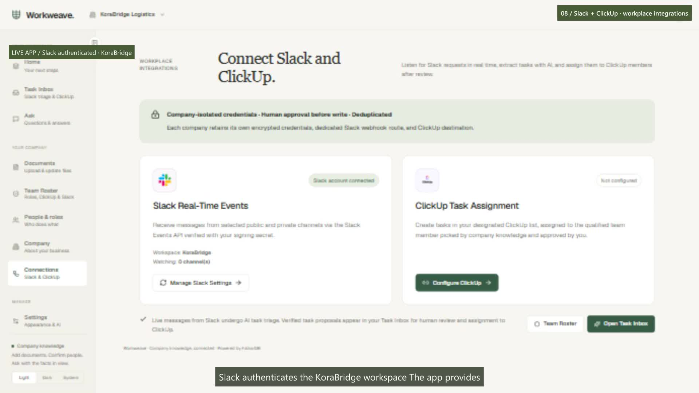
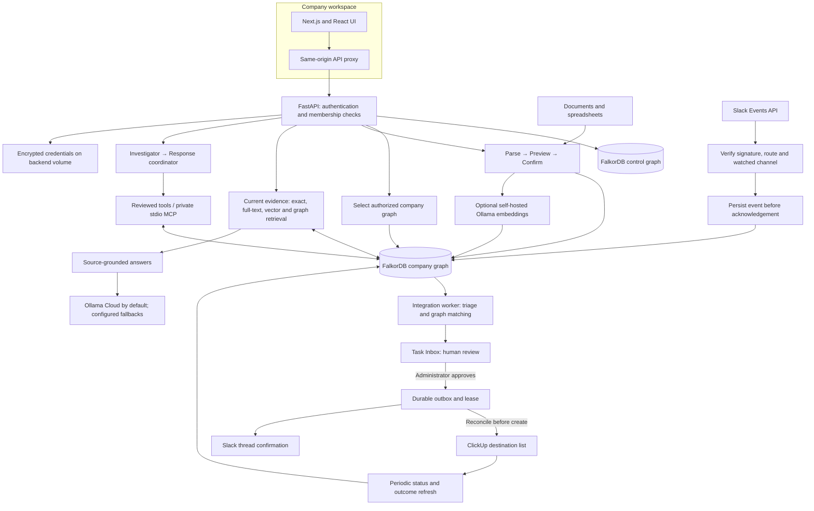
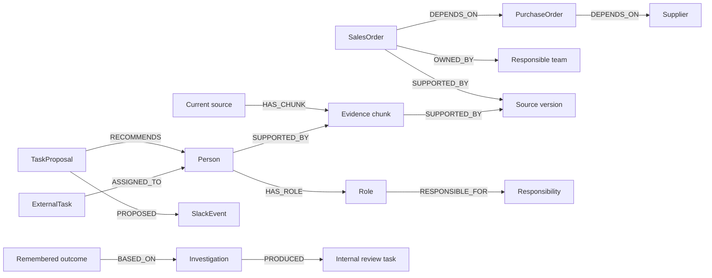

# Workweave

### Company knowledge that connects to coordinated work.

Ask a company question. Follow the evidence. Understand what a change affects. Keep the next step—and its outcome—in memory.

[](https://www.falkordb.com/)


**[Open the live app](https://workweave-web.fly.dev) · [Watch the demo](https://raw.githubusercontent.com/Haleem-code/Workweave/main/docs/media/workweave-demo-3m50s.mp4) · [Read the build story](docs/workweave-blog.md) · [Try a company pack](docs/testing/README.md)**

Workweave connects documents, people, responsibilities, operational dependencies, and remembered outcomes in **FalkorDB**. It helps a team answer three practical questions:

- **What do we know?** Ask about current company documents and inspect the cited source.
- **What does this change affect?** Follow recorded dependencies, check dates and stock, and explain which commitments need attention.
- **Who should act next?** Review a graph-supported task proposal before approving an external action.

**Named submission track: Company Brain.** Persistent memory, internal handoffs, and connected-data actions support that central company knowledge workflow.

## Watch the working app · 3 minutes 50 seconds

[](https://raw.githubusercontent.com/Haleem-code/Workweave/main/docs/media/workweave-demo-3m50s.mp4)

**[Play/download MP4](https://raw.githubusercontent.com/Haleem-code/Workweave/main/docs/media/workweave-demo-3m50s.mp4) · [Repository video file](docs/media/workweave-demo-3m50s.mp4) · [Captions](docs/media/workweave-demo-3m50s.srt)**

The complete video is included in this repository: **1080p, 30 fps, synthetic narration, captions, and 230 seconds**. If your Markdown reader does not play MP4 inline, use the direct video link or download it. The public links become available when these files are pushed to the repository's `main` branch.

| Time | What you see |
| --- | --- |
| 0:00–0:32 | The problem and company onboarding |
| 0:32–1:00 | Document preview, confirmation, and company context |
| 1:00–1:35 | An answer, its citation, a missing fact, and conversation history |
| 1:35–2:25 | A supplier-delay investigation, exclusions, ownership, and handoff |
| 2:25–2:50 | Task completion and an outcome that survives refresh |
| 2:50–3:25 | KoraBridge Slack authentication, event setup, roster, Task Inbox, and ClickUp setup |
| 3:25–3:50 | FalkorDB architecture and closing |

**Recording scope:** Slack authenticated successfully as KoraBridge. Channel discovery still returned `missing_scope`, so live channel monitoring is labelled pending. ClickUp is shown as setup-only; no live ClickUp task or live Slack-to-ClickUp dispatch is claimed. The automated integration tests exercise that complete flow with real FalkorDB and controlled external API responses.

## One change. A useful explanation.

In the included **Harbor Supply** example, a supplier shipment moves to October 23. Workweave follows the purchase order's recorded dependencies and checks the actual commitments:

| Commitment | Result | Why |
| --- | --- | --- |
| SO1 · Acme cartons | Needs review | Its required date precedes the new arrival; stock is insufficient |
| SO2 · Beacon cartons | Needs review | Its required date also precedes the new arrival |
| SO3 · Later cartons | Excluded | Its required date is after the new arrival |
| SO4 · Tape with stock | Excluded | Available unallocated stock covers the order |
| SO5 · Unrelated tools | Not assessed | It is outside this purchase order's dependency paths |

The result is more than a list of matching records: it includes paths, supporting evidence, the responsible team, internal review tasks, and a remembered outcome. **A graph connection identifies a candidate; dates, quantities, stock, and current evidence determine the finding.**

This example is explicitly deterministic. It demonstrates the real graph workflow without presenting a scripted result as an LLM response.

## Architecture



The browser never receives provider secrets from the backend. Company facts and workflow state live in FalkorDB; the separate encrypted vault holds credentials. The hosted frontend and backend run as two Fly apps from this monorepo.

For an ordinary question, current evidence is retrieved before answering. Relationship-dependent investigations use reviewed tools. Slack triage is a separate background workflow; it does not require the model to generate database queries.

**[Detailed architecture and sequence diagrams](docs/architecture.md) · [Graph model](docs/graph-model.md) · [Cypher catalogue](docs/graph-queries.cypher)**

## The graph does real work

There is one `ww_control` graph for accounts, memberships, policies, and integration routes. Each company has its own `ww_company_<identifier>` knowledge graph. Membership checks select the tenant graph; private conversation and episode access also checks the user.



Removing FalkorDB removes retrieval, dependency traversal, assignment paths, conversations, persisted jobs, and memory. There is no alternate business database that keeps these workflows running.

### Example: explain an impact

The application uses this bounded, parameterized dependency traversal before applying its business checks:

```cypher
MATCH path=(o:Entity {entity_type:'SalesOrder',active:true})
  -[:DEPENDS_ON*1..4]->(target:Entity {id:$id,active:true})
WHERE all(n IN nodes(path) WHERE n.active=true)
MATCH (o)-[:DEPENDS_ON]->(po:Entity {entity_type:'PurchaseOrder',active:true})
OPTIONAL MATCH (o)-[:DEPENDS_ON]->(product:Entity {entity_type:'Product',active:true})
RETURN DISTINCT o.payload AS order_json, po.payload AS po_json,
  product.payload AS product_json, [n IN nodes(path) | n.id] AS path_ids
ORDER BY o.required_date
```

### Example: find eligible assignees

```cypher
MATCH path=(person:Person)-[:HAS_ROLE]->(role:Role)
  -[:RESPONSIBLE_FOR]->(responsibility:Responsibility)
WHERE person.active=true AND person.confirmed=true AND person.clickup_id <> ''
  AND any(term IN $terms
    WHERE toLower(role.name + ' ' + responsibility.text) CONTAINS term)
OPTIONAL MATCH (task:ExternalTask)-[:ASSIGNED_TO]->(person)
RETURN person.payload AS person, [n IN nodes(path) | n.id] AS path_ids,
  collect(task.payload) AS tasks
LIMIT 200
```

FalkorDB performs candidate and task-ownership joins and returns actual stored path IDs. Python scores the bounded results using responsibility overlap, similar on-time outcomes, overdue/reassigned outcomes, and current workload. Stale attached document evidence is excluded. Confirmed manual roles are possible; an uncited manual entry is not represented as a document-derived fact.

## Memory that survives the conversation

| Memory | Stored context | What it enables |
| --- | --- | --- |
| Semantic | Accepted records, company facts, people, roles, current evidence | Answers grounded in the company's knowledge |
| Episodic | Conversations, investigations, findings, tasks, outcomes | Returning to what happened and what was done |
| Procedural | Approved, versioned procedures | Consulting the current process during an investigation |
| Coordination state | Run checkpoints, handoff payloads, proposals, inbox/outbox jobs and delivery receipts | Continuing work after interruption and reviewing responsibility |

An internal investigator-to-coordinator handoff is stored in the investigation's payload and event log. This is a bounded application workflow, not a claim of independently deployed autonomous agents or production-scale multi-agent throughput.

## Try it with four fictional companies

1. [Open Workweave](https://workweave-web.fly.dev) and create an email/username account; Google sign-in is optional.
2. Choose your work area and starting focus. Onboarding personalizes guidance, rather than inventing business facts or generating a different application.
3. Upload the three files from one company pack, preview them, and confirm each import.
4. Review **Company** and **People & roles**, then ask a question and open its citation.
5. Refresh and use **History** to revisit the conversation. Use a separate workspace for each company.

| Synthetic company | Pack | A useful first question |
| --- | --- | --- |
| KoraBridge Logistics | [Delivery operations](docs/01_korabridge_logistics/) | Who owns Project Atlas, and what are its budget and target date? |
| Sunvale Energy Systems | [Energy projects](docs/02_sunvale_energy/) | Who owns Project Lumen, and which site is blocked? |
| Cedargrain Foods | [Production and quality](docs/03_cedargrain_foods/) | Who can release CGF-LOT-410, and is a release date confirmed? |
| Meridian Harbor Software | [Software operations](docs/04_meridian_harbor_software/) | Who owns Atlas, when is it planned, and has it shipped? |

The packs contain a searchable PDF profile, Markdown procedure, and text report. The [reviewer guide](docs/testing/README.md) supplies 24 questions and a separate answer key. **Do not upload the questions or answer key into the app.** Reused names help test tenant isolation; deliberately absent facts test whether the assistant admits missing information.

Narrative documents test company answers. Operational supplier/order dependencies require supported structured mappings; uploading an arbitrary paragraph does not create a complete operational graph.

For the dependency demo, choose **Home → Try the example**. It creates a separate Harbor Supply workspace, keeping the current company separate.

## Connect Slack and ClickUp

**Slack:** connect a bot token, Signing Secret, and optional App ID in **Connections**. Copy the public HTTPS request URL into Slack Event Subscriptions, subscribe to the relevant message events, invite the bot, and select only your synthetic demo channels. **Selecting no channels monitors none.**

**ClickUp:** connect a personal API token and the numeric destination list ID. In **Team Roster**, confirm responsibilities and map eligible people to their ClickUp user IDs. An administrator then reviews **Task Inbox → Approve & Create in ClickUp**.

```mermaid
sequenceDiagram
  participant S as Slack
  participant API as FastAPI
  participant G as FalkorDB
  participant W as Integration worker
  participant H as Workspace administrator
  participant C as ClickUp
  S->>API: Signed message event
  API->>API: Verify route, signature, team and watched channel
  API->>G: Persist event once
  API-->>S: Acknowledge
  W->>G: Claim event; traverse assignment graph
  W->>G: Save proposal, candidates and evidence
  H->>API: Review or edit; approve
  API->>G: Save deterministic outbox record
  W->>G: Claim with lease and owner
  W->>C: Search for existing task marker
  alt Existing task found
    C-->>W: Reconcile its task ID
  else Complete search and no prior uncertain create
    W->>C: Create approved task
  else External outcome is uncertain
    W->>G: Pause instead of blindly recreating
  end
  W->>G: Save external task and delivery state
  W->>S: Thread confirmation
  W->>G: Save receipt and completion state
```

Retries reconcile existing tasks, and stale workers cannot advance jobs after losing ownership. If a write may have succeeded but its response was lost, the worker does not blindly send it again. Failed Slack confirmation remains pending/failed; a created ClickUp task is retained. These safeguards reduce duplicate writes; they are **not an exactly-once guarantee from external APIs**.

**[Permissions, setup, troubleshooting and current limits](docs/workplace-connections.md)**

## Run locally

Requirements: Docker with Linux containers, an available port **8080**, and a configured answer provider if you want model-generated answers.

From the repository root, **only if `.env` does not already exist**, copy `.env.example` to `.env`. Set your own bootstrap admin password and provider configuration privately. Never overwrite existing configuration or commit credentials.

```bash
docker compose up -d --build
docker compose exec ollama ollama pull embeddinggemma:300m
```

Open **http://localhost:8080** and create an account. The stack starts the frontend, API, local FalkorDB, and Ollama. Application defaults prefer **Ollama Cloud (`gemma4:31b`)**, followed by enabled/configured **Groq → Gemini → self-hosted Ollama** fallbacks. Provider policy can restrict those choices.

Set `WORKWEAVE_OLLAMA_CLOUD_KEY` privately on the backend. Chat and embeddings are separate: semantic document indexing uses `embeddinggemma:300m` from the configured self-hosted Ollama service. Without embeddings, exact/full-text and confirmed graph retrieval remain available with semantic search reported as degraded.

For fully local chat:

```bash
docker compose exec ollama ollama pull qwen3:8b
```

Then select self-hosted Ollama in **Settings → AI answers** and save preferences.

Already using FalkorDB Cloud? Configure the host, port, credentials, and TLS privately, follow [cloud setup](docs/cloud-setup.md), and use this alternative instead of the local Compose stack:

```bash
docker compose -f docker-compose.cloud.yml up -d --build
```

For local Slack events, configure a reachable HTTPS callback/tunnel. A localhost URL cannot receive Slack's hosted webhook deliveries.

## Deployment and verification

| Component | Location |
| --- | --- |
| Frontend | [workweave-web.fly.dev](https://workweave-web.fly.dev) |
| Backend health | [workweave.fly.dev/api/v1/health](https://workweave.fly.dev/api/v1/health) |
| Frontend source | [`workweave-web/`](workweave-web/) |
| Backend source | [`workweave-api/`](workweave-api/) |
| Deployment guides | [Frontend/Google](docs/fly-frontend.md) · [Backend](docs/fly-backend.md) |

From the repository root, these deploy the two apps:

```bash
fly deploy ./workweave-api -a workweave
fly deploy ./workweave-web -a workweave-web
```

GitHub pushes deploy automatically only if the corresponding integration/workflow is configured. Configure secrets in Fly, and set `WORKWEAVE_PUBLIC_BASE_URL` to the backend's public HTTPS URL.

**Latest complete backend verification: 57 tests passed** in a Linux container against disposable real FalkorDB. External Slack/ClickUp HTTP responses were controlled, not live-account writes. Coverage includes real assignment paths, stale-source exclusion, atomic claims, parallel workers, ambiguous external responses, approval gating, reply retries, tenant isolation, private MCP, source versions, and recovery. The frontend production build and TypeScript check passed.

**[Reproduce the tests](docs/development-and-demo.md) · [Verification record](docs/submission-audit.md)**

### Current boundaries

- The recorded live integration verifies Slack authentication, not completed channel monitoring or live ClickUp dispatch.
- The token-based integration is administrator configured; public multi-customer OAuth installation is future work.
- The worker uses bounded batches and polling; high-throughput, multi-region operation has not been benchmarked.
- Google consent and hosted embedding availability require their own checks. A health response does not prove every provider or connector is ready.
- Supported uploads: CSV, XLSX, text-based PDF, DOCX, Markdown, and text, up to 10 MB each. Scanned-PDF OCR is not implemented.
- Suggested roles require review. External tool messages are untrusted input; model output does not grant permissions.
- No automatic rider telemetry, universal company connector, or arbitrary document-to-operational-schema inference is claimed.

## Submission, data and authorship

**Track: Company Brain.** The submission includes source, setup instructions, the graph model, core queries, a complete demo video, and a live app. Use only synthetic or otherwise event-permitted data for judging.

**AI assistance:** OpenAI Codex assisted with implementation, fixes, tests, deployment, documentation, and video preparation. The participant directed the product, company scenarios, integrations, and acceptance feedback. Narration is synthetic, using Microsoft Sonia through Edge TTS. The submitter must understand and explain the submitted code and design.

**Build history:** earlier documentation described a pre-event prototype. That disclosure is preserved in [submission history](docs/submission-disclosure.md); this README does not assert that all implementation began during the event or that eligibility has been confirmed. The [organizer's rules](https://www.wemakedevs.org/hackathons/falkordb/rules) govern eligibility.

## Explore the implementation

[Architecture](docs/architecture.md) · [Graph model](docs/graph-model.md) · [Cypher](docs/graph-queries.cypher) · [Integrations](docs/workplace-connections.md) · [Company packs](docs/testing/README.md) · [Build story](docs/workweave-blog.md)
