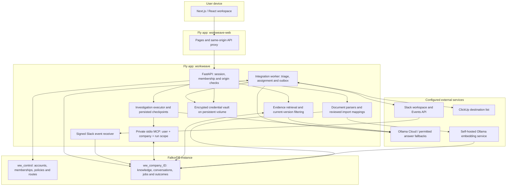
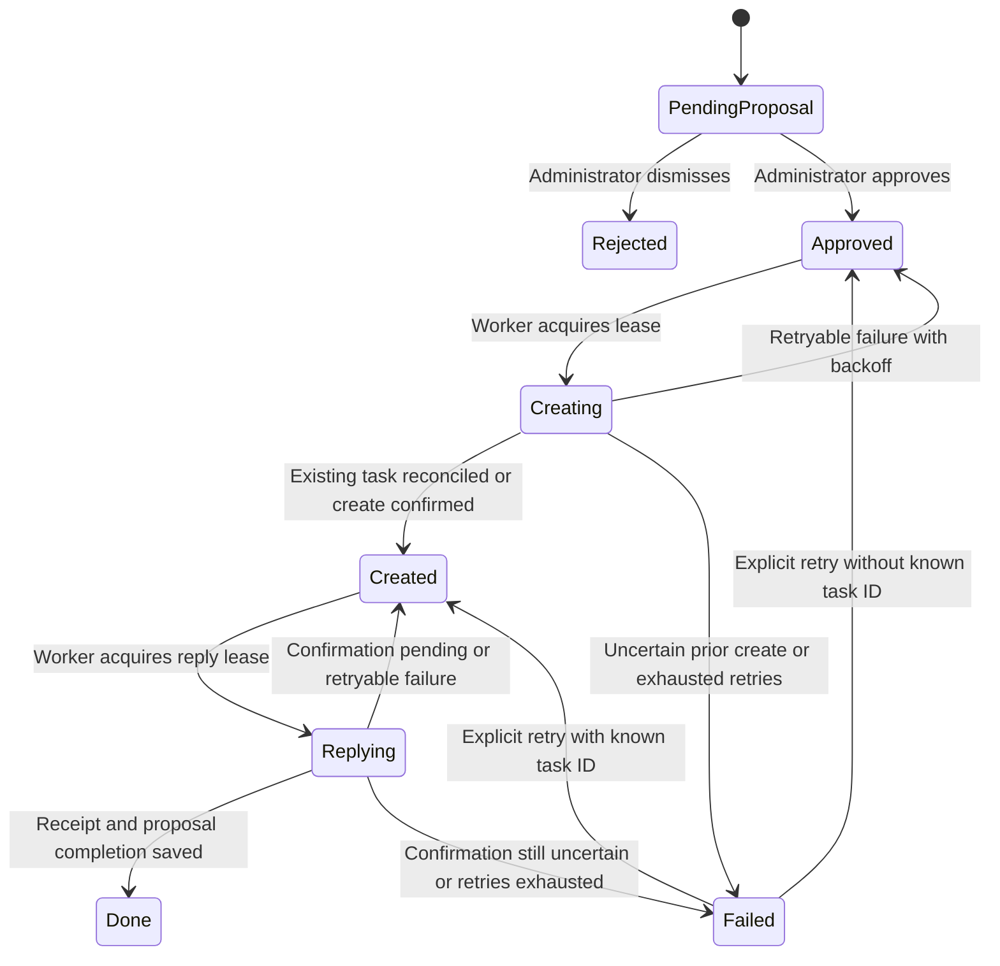

# Workweave architecture

Workweave has two related workflows: company questions and operational investigations, plus a workplace integration pipeline that turns selected Slack requests into reviewed ClickUp actions. They share an authorized company graph in FalkorDB.

[Back to README](../README.md) · [Graph schema](graph-model.md) · [Queries](graph-queries.cypher) · [Demo](media/workweave-demo-3m50s.mp4)

## 1. Components and trust boundaries



The control graph is not a shared company document store. Membership determines which company graph the request may access. Private conversation and episode records additionally carry user ownership checks. Slack routes bind a signed event to its configured company and team; only selected channels are accepted.

Credentials are separate from business knowledge. The backend volume contains the encrypted vault and its encryption key. Volume permissions, backup, and key protection remain deployment responsibilities; encryption is not a substitute for host security.

## 2. Documents become reviewed, versioned evidence

```mermaid
sequenceDiagram
  participant U as User
  participant API as FastAPI
  participant P as Parser and mapping review
  participant G as Company graph
  participant E as Embedding service
  U->>API: Upload supported document or spreadsheet
  API->>P: Parse sections or rows; prepare preview
  P-->>U: Preview and proposed mappings
  U->>API: Confirm import
  API->>G: Store source, version, chunks and mapped records
  API->>G: Link evidence and confirmed dependencies
  API->>E: Request compatible embeddings
  alt Embeddings available
    E-->>API: 768-dimensional vectors
    API->>G: Index vectors
  else Embeddings unavailable
    API->>G: Record degraded semantic indexing
  end
  API-->>U: Accepted source and indexing status
```

The model does not decide that arbitrary columns are supplier or purchase-order relationships without a supported mapping. A narrative profile can answer company questions without becoming an order-management database. Current evidence filtering checks source activity, import completion, and matching source versions. Revoked or superseded evidence must not support a current answer.

## 3. Questions and investigations

For ordinary questions, retrieval combines exact, full-text, optional vector, and graph context. Reciprocal-rank fusion combines search rankings in Python. Some narrow source-backed questions have a direct answer path; other questions use a permitted model with compact evidence. Claims carry evidence IDs for review.

Questions requiring relationship tools can open a private MCP session bound to a user, company and run. The approved catalogue is:

| Tool | Purpose |
| --- | --- |
| `search_knowledge` | Retrieve current evidence |
| `trace_impact` | Traverse confirmed dependencies and evaluate business impact |
| `find_owner` | Resolve the current responsible team |
| `get_procedure` | Read the current approved procedure |
| `recall_episode` | Retrieve permitted remembered outcomes |
| `create_review_task` | Create an internal task from an eligible finding in the current run |

These tools use reviewed parameterized statements. The model does not submit free-form Cypher. Tool/entity validation constrains access; prompts or source documents do not grant permissions.

The Harbor Supply example uses the same graph tools and persistence, with a deterministic explanation rather than a cloud-model answer. The investigator stores findings and a handoff; the response coordinator creates internal tasks. Their handoff is payload/event state on the Run, not a graph of independently operating agent processes.

## 4. Slack ingestion and graph-supported assignment

```mermaid
flowchart LR
  Event["Signed Slack event"] --> Verify["Validate signature, timestamp, route and team"]
  Verify --> Filter["Require explicit watched channel"]
  Filter --> Persist["Create event once in tenant graph"]
  Persist --> ACK["Acknowledge delivery"]
  Persist --> Claim["Worker claims event"]
  Claim --> Enrich["Resolve author after acknowledgement"]
  Enrich --> Extract["Model extracts proposed work"]
  Extract --> Traverse["FalkorDB traverses eligible people and past tasks"]
  Traverse --> Score["Python scores bounded graph results"]
  Score --> Proposal["Persist proposal and explanation"]
  Proposal --> Human["Administrator reviews and approves"]
```



Dedupe IDs derive from company ID and Slack event ID, falling back to channel/message timestamp when necessary. An empty watch list accepts no message events. Bot messages and message edits/deletions are excluded by this initial intake path.

The assignment read model contains `Person → HAS_ROLE → Role → RESPONSIBLE_FOR → Responsibility`, with `ExternalTask → ASSIGNED_TO → Person` for history. Existing roster records are projected into that graph. Returned path IDs identify real nodes.

Eligible automatic candidates must be active, confirmed and mapped to a ClickUp identity. Matching uses responsibility/role keywords. The bounded result is scored using responsibility overlap, similar on-time completions, overdue/reassigned work, and open workload. This is a transparent heuristic, not a learned performance model or a guarantee of assignment quality.

If attached evidence has become stale, the candidate is excluded until reviewed. A manually confirmed role can exist without source citations; the UI must not describe that as a verified document extract. If extraction fails, the request can require manual triage rather than claiming that AI completed the classification.

## 5. External actions and failure recovery



Job claims use a graph-side conditional update. Reads merge canonical state/lease/attempt properties with serialized payloads. Subsequent job updates check owner and lease validity, so stale workers cannot overwrite newer progress.

Every approved proposal has a deterministic outbox ID and external marker. A complete successful marker search is required before creating a ClickUp task. Search errors or exhausted search bounds do not count as proof of absence. Before sending a create, the worker persists a `create_started` flag. If a response is lost, retries search for the marker; they do not automatically resend an uncertain non-idempotent write.

The worker stores the ClickUp task ID and restores its graph assignment even after reconciliation. Slack delivery is tracked separately. A known rejected Slack send may be retried; an uncertain send requires receipt/history reconciliation. Missing history permissions or an unresolved outcome can therefore leave the job needing manual attention. The system does not claim an external exactly-once transaction across FalkorDB, ClickUp and Slack.

The worker periodically refreshes task outcomes. Current bounded scans and status handling are an MVP implementation, not a comprehensive audit of all historical tasks or custom workflows. Completion without a confirmed due/completion comparison is not treated as proven on-time performance.

## 6. Memory and isolation

- **Semantic context:** accepted facts, people, roles, dependencies and current evidence.
- **Episodic context:** conversations, investigations, findings and outcomes.
- **Procedural context:** approved, versioned procedures.
- **Coordination context:** checkpoints, handoff payloads, proposal state, leases, task IDs and receipts.

Company knowledge is tenant-separated; private memory is user-scoped. A separate graph name is one part of isolation, not the entire access-control model. Authorization must precede graph selection and tool execution.

## 7. Implementation map

| Concern | Source |
| --- | --- |
| API/auth and workspace boundaries | [`main.py`](../workweave-api/workweave_api/main.py) |
| Graph adapter, scalar decoding, indexes | [`graph.py`](../workweave-api/workweave_api/graph.py) |
| Record store, atomic claims and fenced saves | [`store.py`](../workweave-api/workweave_api/store.py) |
| Imports and versions | [`ingestion.py`](../workweave-api/workweave_api/ingestion.py) |
| Retrieval and operational tools | [`retrieval.py`](../workweave-api/workweave_api/retrieval.py), [`tools.py`](../workweave-api/workweave_api/tools.py) |
| Investigations and private MCP | [`engine.py`](../workweave-api/workweave_api/engine.py), [`mcp_server.py`](../workweave-api/workweave_api/mcp_server.py) |
| Integration endpoints | [`integrations.py`](../workweave-api/workweave_api/integrations.py) |
| Graph assignment and extraction | [`assignment.py`](../workweave-api/workweave_api/assignment.py), [`triage.py`](../workweave-api/workweave_api/triage.py) |
| Durable external work | [`outbox.py`](../workweave-api/workweave_api/outbox.py) |
| Credentials and external clients | [`credentials.py`](../workweave-api/workweave_api/credentials.py), [`slack_client.py`](../workweave-api/workweave_api/slack_client.py), [`clickup_client.py`](../workweave-api/workweave_api/clickup_client.py) |
| Browser workspace and proxy | [`workweave-web/src`](../workweave-web/src/) |

## 8. What was actually verified

The final complete backend suite passed **57 tests** in Linux using disposable real FalkorDB and controlled external API responses. It includes an end-to-end signed Slack event → graph candidate → approval → ClickUp response → Slack confirmation test. Concurrent claims and duplicate-prevention failure paths have real-database regression coverage. The frontend production build and TypeScript check passed.

In the public recording, Slack authentication succeeded for the synthetic KoraBridge workspace; channel listing lacked permissions, and no watched channel/live task dispatch was verified. ClickUp appears as setup-only. Complete Google consent, hosted embedding readiness, broad external-account compatibility, and production-scale throughput are separate verification tasks.
