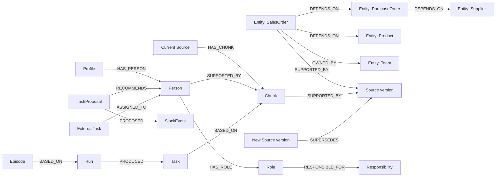

# How Workweave uses FalkorDB

## One control graph, one knowledge graph per company

`ww_control` stores accounts, sessions, memberships, and company policies.
Company knowledge is stored separately in `ww_company_<identifier>`. Membership
is checked before the backend selects a company graph. Conversations and private
episodes also carry an author check; knowing a company ID does not grant access.

FalkorDB stores the business records, excerpts, evidence versions, people,
procedures, runs, tasks, conversations, and outcomes. There is no secondary
business-record store that replaces the graph when it goes offline. The encrypted
credential vault is separate and holds provider/OAuth secrets, not company facts.

## Actual labels and relationships

Stored application records have the `Record` label plus a typed label such as `Entity`,
`Source`, `Chunk`, `Person`, `Profile`, `Procedure`, `Run`, `Task`, `Episode`,
`Conversation`, or `Message`. Stable `id`, `kind`, `active`, and `updated_at`
properties support retrieval. Full records are serialized in `payload`.
`Entity` additionally projects business fields such as `name`, `entity_type`,
dates, stock, quantity, and owner for Cypher. `Chunk` projects searchable text
and, when indexing succeeds, an embedding. Assignment projection nodes `Role` and
`Responsibility` have stable IDs and graph properties rather than full `Record`
payloads. `SlackEvent`, `TaskProposal`, `Outbox`, and `ExternalTask` are persisted
record kinds. Canonical job state, attempts, owner, and lease timestamps are also
projected onto job nodes; reads overlay those properties onto the payload.
A `Source` can be the current source
record or a historical version record; `is_version` is inside its payload.



This drawing combines relationships that can exist across the imported-data and
workflow paths. It does not claim every uploaded document creates every node.
The Investigator-to-coordinator handoff is persisted in the Run's payload and
events, not represented as an independent pair of autonomous agent nodes.
Conversation/message association and some memory metadata are also stored in
payload fields; not every association has a materialized edge.

## Why paths matter

`trace_impact` walks up to four `DEPENDS_ON` edges from a customer commitment to
the changed supplier or purchase order. The returned path makes the connection
inspectable. Application code then checks current source versions, arrival and
required dates, quantities, and unallocated stock. A connection identifies a
candidate; those checks decide whether it warrants a task.

For Harbor Supply, delaying PO1 to October 23 affects SO1 and SO2. SO3 is due
later; SO4 is covered by stock; SO5 uses an unrelated purchase order. Excluding
these three is part of correctness, rather than reporting every connected order.

## Retrieval and memory

Search combines exact matches, full-text results, and cosine vector results using
reciprocal-rank fusion in Python. Confirmed dependency and ownership edges expand
the context. Inactive, revoked, or superseded evidence is filtered. Small corpora
can skip vector lookup; missing embeddings are reported as degraded semantic
search rather than silently being described as fully indexed.

Episodes retain a run and its outcome. Procedures are approved, versioned records.
Run checkpoints and deterministic task IDs let the executor reconcile work after
a restart. One background executor coordinates this workflow; this is not a
distributed, high-throughput multi-agent runtime.

The model chooses from reviewed tools. It cannot submit arbitrary Cypher. Tool
arguments are schema checked, entity identifiers must resolve, and an internal
task needs a finding from its own run with current evidence. The private stdio
MCP server additionally binds tools to a user, company, and run.

## Queries and source files

Assignment traverses confirmed, active, ClickUp-mapped people through stored role
and responsibility nodes, joins their assigned external tasks, and returns real
path IDs. Python scores the bounded query results; stale attached evidence is
excluded. The outbox links to its proposal via a payload field, not an invented
graph edge. See [architecture](architecture.md) for sequence and recovery diagrams.

Read [graph-queries.cypher](graph-queries.cypher) for the actual traversal,
ownership, expansion, retrieval, persistence, and indexing templates. The
parameterized statements are executed separately; this file is not a migration
script to run in one batch.

| Responsibility | Implementation |
| --- | --- |
| Query adapter and indexes | [graph.py](../workweave-api/workweave_api/graph.py) |
| Record storage and permitted edges | [store.py](../workweave-api/workweave_api/store.py) |
| Confirmed table mappings and versions | [ingestion.py](../workweave-api/workweave_api/ingestion.py) |
| Search and current-evidence filtering | [retrieval.py](../workweave-api/workweave_api/retrieval.py) |
| Traversal, owners, procedures, and actions | [tools.py](../workweave-api/workweave_api/tools.py) |
| Checkpoints, handoff, and episodes | [engine.py](../workweave-api/workweave_api/engine.py) |
| Scoped MCP endpoint | [mcp_server.py](../workweave-api/workweave_api/mcp_server.py) |

In FalkorDB Browser select your company's graph and start with:

```cypher
MATCH (n) RETURN labels(n) AS labels, count(n) AS count
```

Then use the bounded inspection query at the end of the query file. Browser node
numbers are database identifiers; inspect properties to see the persisted record.
