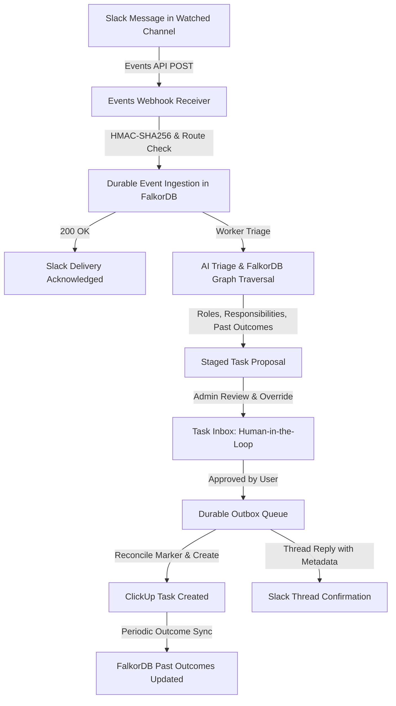

# Live Workplace Integrations: Slack & ClickUp

Workweave connects directly to **Slack** and **ClickUp** to provide an intelligent, graph-driven work assignment pipeline:



---

## 1. Architecture & Guarantees

1. **Durable Ingestion Before Acknowledgement**: Every inbound Slack event is cryptographically verified (HMAC-SHA256 signature and 5-minute replay window) and durably written to the company store before the HTTP 200 response is returned. Duplicate delivery retries from Slack are deduplicated by `(channel, message_ts)`.
2. **FalkorDB Graph-Driven Matching**: Assignees are not picked arbitrarily. FalkorDB traverses candidate roles, confirmed responsibilities, past on-time task outcomes, and active workload to calculate fit scores. Every recommendation links to source evidence chunks.
3. **Strict Human-in-the-Loop Gate**: Zero tasks are created in ClickUp and zero Slack thread replies are sent until a workspace administrator reviews and approves the proposal in the **Task Inbox**.
4. **Idempotent ClickUp Creation**: Every outbox entry carries an unguessable marker (`⟦workweave:{marker}⟧`). On any retry or crash recovery, Workweave searches ClickUp for the marker before issuing a `POST /task`. If the task already exists, it reconciles the existing ID rather than creating a duplicate.
5. **Multi-Tenant Isolation**: Each company receives an isolated route ID (`/api/v1/integrations/slack/events/{route_id}`), encrypted vault credentials, exclusive channel claims, and independent ClickUp list destinations.

---

## 2. Slack Setup Guide

### Step 1: Create Slack App
1. Go to [api.slack.com/apps](https://api.slack.com/apps) and click **Create New App → From scratch**.
2. Give your app a name (e.g. `Workweave Dispatcher`) and select your Slack workspace.

### Step 2: Configure Scopes
Navigate to **OAuth & Permissions → Scopes → Bot Token Scopes** and add:
- `channels:history`: Read messages in public channels.
- `groups:history`: Read messages in private channels.
- `channels:read`: List public channels for selection.
- `groups:read`: List private channels for selection.
- `users:read`: Resolve author names and Slack user IDs.
- `chat:write`: Post task confirmation replies back into Slack threads.

### Step 3: Install App & Copy Credentials
1. Under **Install App**, click **Install to Workspace** and authorize permissions.
2. Copy the **Bot User OAuth Token** (starts with `xoxb-...`).
3. Under **Basic Information → App Credentials**, copy the **Signing Secret** and **App ID**.

### Step 4: Configure in Workweave
1. In Workweave, navigate to **Connections → Slack**.
2. Paste the **Bot Token**, **Signing Secret**, and **App ID**, then click **Save & Connect Slack**.
3. Workweave displays your unique **Request URL**:
   ```text
   https://<your-host>/api/v1/integrations/slack/events/<unique_route_id>
   ```
4. Copy this URL, return to Slack's **Event Subscriptions** page, toggle **Enable Events** to `On`, paste the URL into **Request URL**, and wait for the `Verified` badge.
5. Under **Subscribe to bot events**, add `message.channels` and `message.groups`, then click **Save Changes**.

### Step 5: Select Watched Channels
In Workweave **Connections → Slack Channels**, browse all public and private channels the bot has access to. Toggle the channels you wish Workweave to monitor for work requests.

---

## 3. ClickUp Setup Guide

### Step 1: Retrieve Personal API Token
1. In ClickUp, open your avatar menu → **Settings → Apps / ClickUp API**.
2. Under **API Token**, generate or copy your personal token (starts with `pk_...`).

### Step 2: Find Your Destination List ID
1. Open the ClickUp Space and List where tasks should be created.
2. In the browser URL bar or list share link, copy the numeric identifier:
   - Example: `https://app.clickup.com/1234567/v/li/987654321` → List ID is `987654321`.

### Step 3: Configure in Workweave
1. In Workweave, open **Connections → ClickUp**.
2. Paste your **ClickUp Token** and **List ID**, then click **Save & Connect ClickUp**.
3. Workweave verifies access against ClickUp's `/api/v2/list/{id}` endpoint and displays your list name.

---

## 4. Team Roster Setup

Before assigning tasks, establish team identity mappings in **Team Roster** (`/` sidebar → **Team Roster**):

1. **Add or Edit Member**:
   - **Full Name**: e.g. `Sarah Jenkins`
   - **Role**: e.g. `Backend Engineer`, `Frontend Lead`, `DevOps`
   - **Responsibilities**: Detailed domain scope (e.g. `PostgreSQL, Redis caching, user authentication, billing pipelines`).
   - **ClickUp Member**: Select or input the member's numeric ClickUp User ID.
   - **Slack User ID**: Input the member's Slack handle / user ID (e.g. `U01234567`).
   - **Evidence Citations**: Link to uploaded company documents that verify these responsibilities.
2. **FalkorDB Synchronization**:
   Saving updates the member's node and relations (`Person`, `Role`, `Responsibility`, `SUPPORTED_BY`) in FalkorDB, updating the assignment graph immediately.

---

## 5. End-to-End Triage & Approval Flow

1. **Inbound Message**:
   A team member posts a request in a watched Slack channel:
   > *"The user login endpoint is returning 500 errors when session cookies expire. Can someone patch the auth token validation?"*

2. **AI Triage & Graph Traversal**:
   - The background integration worker extracts key intent: Title (*"Fix session cookie expiration in auth endpoint"*), urgency, and required skills (*"auth", "login", "backend"*).
   - FalkorDB assigns candidate scores by traversing:
     - `Person -[:HAS_ROLE]-> Role`
     - `Person -[:RESPONSIBLE_FOR]-> Responsibility`
     - Past completed tasks with positive outcomes
     - Open task penalty
   - The top candidates are attached to a staged **Task Proposal**.

3. **Human Approval in Task Inbox**:
   - The administrator opens **Task Inbox** (`/` sidebar → **Task Inbox**).
   - Review the Slack message context, AI title/description draft, and recommended assignee.
   - Click the evidence panel to review *"Why this person"* with citations to source documents.
   - Adjust the title or switch to a runner-up candidate if desired.
   - Click **Approve & Create in ClickUp**.

4. **Task Creation & Thread Confirmation**:
   - Workweave claims the outbox entry with an atomic lease.
   - Reconciles ClickUp via `⟦workweave:{marker}⟧` marker search to guarantee zero duplicate tasks.
   - Creates the task in ClickUp assigned to the chosen member.
   - Posts a confirmation message in the Slack thread with a direct link to the new ClickUp ticket:
     > *✅ Task created in ClickUp and assigned to **Sarah Jenkins**:*
     > *<https://app.clickup.com/t/8695pabc|Fix session cookie expiration in auth endpoint>*

5. **Outcome Synchronization**:
   - Workweave periodically queries ClickUp for task status updates.
   - Completed tasks update the assignee's historical track record in FalkorDB, improving future AI triage accuracy.

---

## 6. Security & Credential Isolation

- **Zero Clear-Text Secrets**: Slack tokens, signing secrets, and ClickUp tokens are stored using company-scoped encrypted vaults and never returned in API GET responses.
- **5-Minute Replay Protection**: Inbound Slack requests must have timestamps within 300 seconds of local time to prevent replay attacks.
- **Unguessable Webhook Routes**: Webhook URLs use 128-bit cryptographically random tokens (`/events/{route_id}`). Requests to nonexistent or inactive route IDs are rejected.
- **Conflict Prevention**: Channels can only be claimed by one company workspace at a time.
